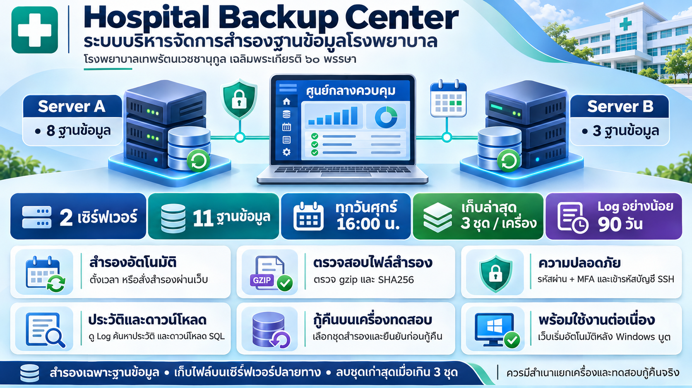

# Hospital Backup Center

ระบบบริหารจัดการสำรองฐานข้อมูลโรงพยาบาล

- สำรองทุกวันศุกร์ 16:00 น. เวลาไทย
- เก็บชุดสำรองสำเร็จล่าสุด 3 ชุดต่อเซิร์ฟเวอร์
- ตั้งค่า SSH, ดาวน์โหลด, ดูพื้นที่และประวัติ, กู้คืนบนเครื่องทดสอบ
- MFA แบบ TOTP พร้อม recovery codes
- Audit log เก็บอย่างน้อย 90 วัน
- เปิดเว็บอัตโนมัติบน Windows ด้วย Task Scheduler และ Waitress

อ่าน [คู่มือติดตั้งและใช้งาน](README_TH.md) และ [คู่มือเปิดระบบอัตโนมัติ](AUTOSTART_TH.md)

Repository นี้เก็บเฉพาะซอร์สโค้ด ภาพประกอบ และไฟล์ตัวอย่าง ไม่รวมรหัสผ่านจริง `.env`, SSH private keys, MFA secrets, recovery codes, ฐานข้อมูลประวัติ, Log หรือไฟล์สำรองฐานข้อมูล ต้องตั้งค่าบัญชีและเปิด MFA ใหม่ในแต่ละเครื่องที่นำไปติดตั้ง
